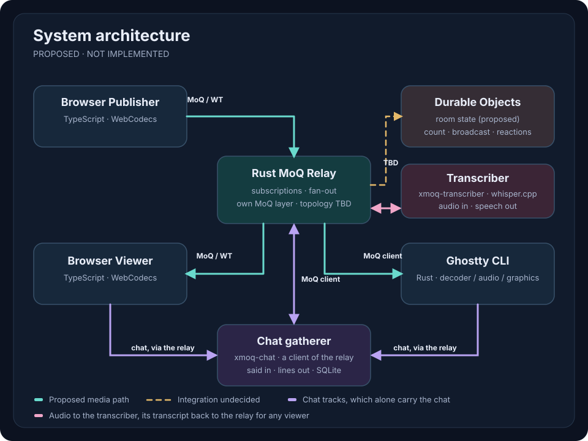
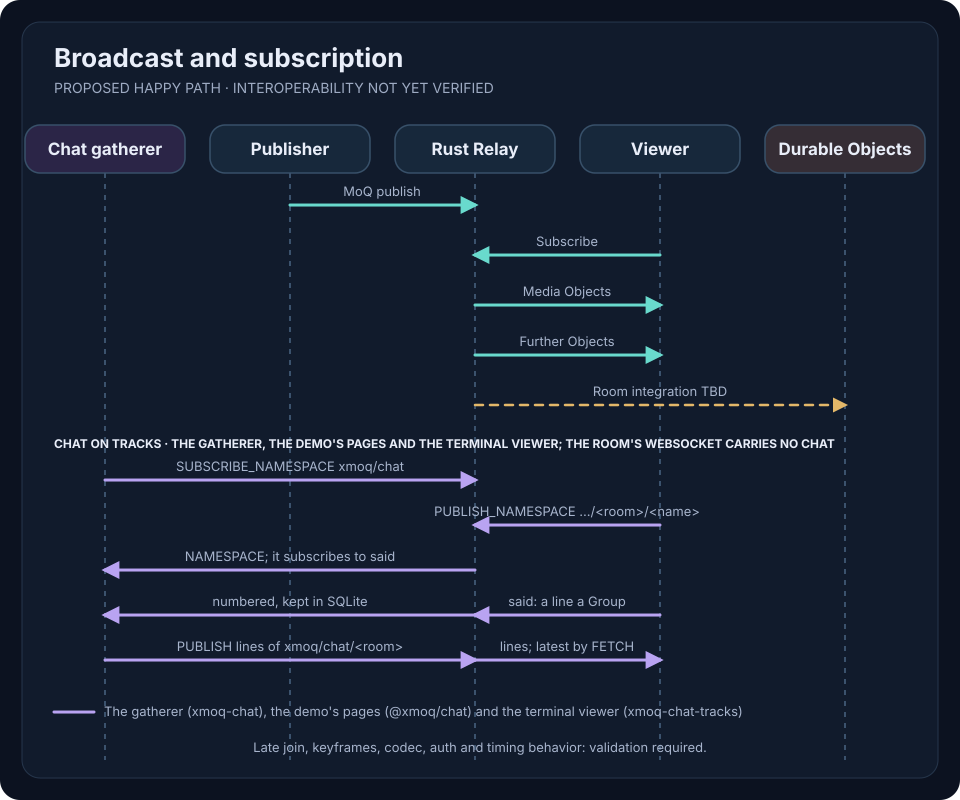

# Architecture — proposed; the MoQ layer and a minimal relay are implemented

The diagram shows **intended component boundaries**, not a tested deployment. Solid arrows are proposed media paths; the dashed connection to Durable Objects is **undecided**. The violet lines are the chat on MoQ tracks: solid for the gatherer (`xmoq-chat`), dotted for the participants' side, which the pages and the terminal viewer do not have yet; they still chat over the room's WebSocket.

## Broadcast flow

This sequence is conceptual. Connection setup, session authentication, MoQ draft interoperability, codec and media timing details are **not yet validated**.

## Responsibilities

- **Browser:** capture, encode, subscribe, decode and render. TypeScript and WebCodecs.
- **Rust Relay:** media subscription and fan-out. The MoQ layer is implemented in this repository (see [protocol layers](protocols.md)). A minimal relay exists: it registers published tracks, answers subscriptions, forwards Objects to every subscriber and ends the subscription of a subscriber that falls too far behind. It keeps the latest Group of a track, where the track's publishers allow it, and answers a FETCH that lies in it itself; any other FETCH it passes on to one publisher, and that publisher's fetch stream back to the subscriber as it is. For a Joining FETCH it works out the range from the subscription the FETCH names. The cache does not outlive the track's last publisher yet, and the relay has no authorization. Deployment remains open.

  A slow subscriber has its own subscription ended (`TOO_FAR_BEHIND`), and the application can subscribe again and resume at the next key frame. What counts as slow is measured per subscriber session, over all the tracks it subscribes to, and the subscription that ends is the one whose stream reached the limit; so a session that falls behind on one track can lose its subscription to another (see [open questions](open-questions.md)). The publisher is not made to wait, because one viewer that does not read would stall the broadcast for everyone. Queued Objects are not dropped one by one, because a missing delta frame makes H.264 and VP8 decoders show corrupt pictures without an error (see the [WebCodecs record](experiments/2026-10-10-webcodecs-loopback.md)).

  A fetch stream goes another way than the Objects of a subscription. The relay reads the publisher only as fast as the subscriber takes the bytes, so a slow subscriber slows its own FETCH, and a subscriber that takes nothing for 10 seconds loses it. What a slow FETCH does hold is the publisher's stream: one of the 64 unidirectional streams the publisher may have open towards the relay, for as long as the subscriber takes. The relay therefore asks one publisher for at most 16 FETCHes at once, which leaves the publisher 48 streams for what it publishes. WHY not the queues of a subscription: a FETCH asks for what exists already, so the publisher sends as fast as its link allows, and any queue would be full at once.

  The relay is four crates. `xmoq-moqt` holds encoding and session state. `xmoq-relay-core` decides which Object goes to which subscriber, which publisher a SUBSCRIBE or a FETCH is passed on to, and what a disconnect ends; it takes events and returns actions and does no I/O, so it is tested without sockets. `xmoq-moqt-io` reads and writes MoQ streams over a `Connection` trait. `xmoq-relay` accepts sessions and connects the other three.
- **Rust CLI:** media subscription, video decoding, Ghostty Kitty Graphics rendering, native audio and chat. A first version is the crate `xmoq-watch` (`crates/watch`): what it decides is a library without input or output, and each kind of input and output is one file of its binary, the video decoder and the sound output among them, since neither is decided. Backends and compatibility require testing.
- **Durable Objects:** proposed room/application state and chat persistence. Relay integration is not decided; direct WebTransport termination at DO is not assumed.

## Boundaries and constraints

Each client uses its own connection to the relay. MoQ Track is a logical data series, not a QUIC stream. WebCodecs does not provide a complete jitter buffer or A/V synchronization pipeline.

Future multiple publishers should not be structurally excluded, but bidirectional media is **not** an initial implementation requirement.

See [protocol layers](protocols.md), [validation](validation.md) and [open decisions](open-questions.md).
