# MoQ Transport state models

The states that both MoQ Transport sessions keep, the Rust one (`crates/moqt`) and the TypeScript one (`packages/moqt`): the session, and each request on it. The states and their transitions are those of `draft-ietf-moq-transport-18`, with its section numbers. Where the draft is silent, contradicts itself or leaves a choice, a transition points to what holds the ruling: the table of `fixtures/` both implementations read, the tests of a crate where one implementation alone has the behaviour, or, where no test can hold it, the item of the [implementation notes](moqt-implementation-notes.md) by its name; what it decides is not repeated here. The relay's own states (a track, its sources, its subscribers) are under [The relay](#the-relay).

Each diagram holds both ends of a request. A transition is labelled with the message or the stream event, and with the end that sends it, where it matters: `SUBSCRIBE_OK (publisher)`. A reset and a STOP_SENDING are the two ways to cancel a request (§3.3.2); a FIN is not one.

## The session

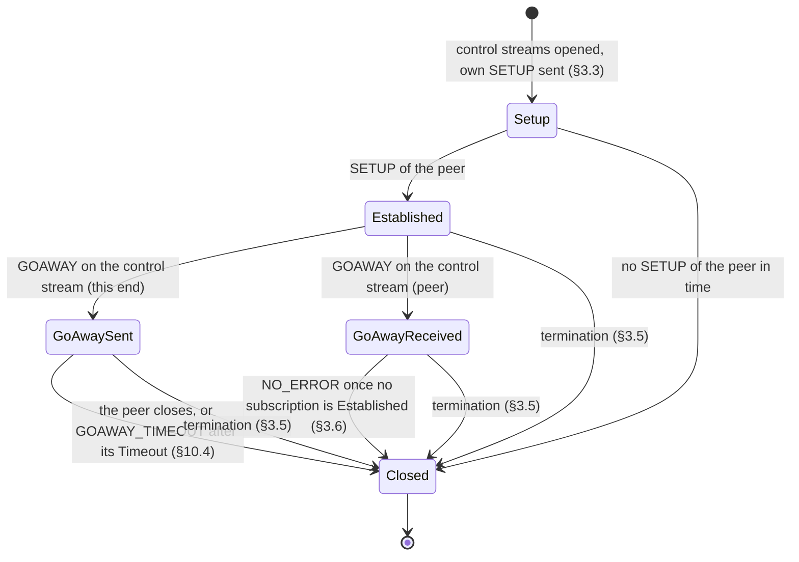

- **Setup.** Objects and requests of the peer can come before its SETUP; §3.3 has them buffered ("SHOULD"). What the clients do with them: `crates/moqt-io/src/client.rs`. How long a SETUP is waited for: [`fixtures/limits/`](../fixtures/limits/README.md).
- **Established.** Either end opens requests, each on a bidirectional stream of its own (§3.3). A control stream that closes closes the session with `PROTOCOL_VIOLATION` (§3.3).
- **After a GOAWAY.** The end that received it opens no new request (§10.4: "SHOULD NOT initiate new requests"); the requests that are open go on. The sender refuses requests whose Request ID is at or above the one its GOAWAY names with `GOING_AWAY` (§10.4). A second GOAWAY on the control stream closes the session with `PROTOCOL_VIOLATION` (§10.4). What each implementation checks of a GOAWAY, and what a client does next: "GOAWAY (§10.4), received". When the relay sends one: `crates/relay-core/src/tests/going_away.rs`.
- **Closed.** By `CLOSE_WEBTRANSPORT_SESSION` with a Session Termination Error Code (§3.5); every request of the session ends with it.

## Every request

These hold for each request below, and are not drawn in each diagram:

- **Cancelled.** Either end cancels a request by resetting or stopping the directions of its stream that are still open (§3.3.2). The request is then over at both ends.
- **Refused before any processing.** REQUEST_ERROR and a FIN (§3.3.2). What still comes from the requester on that stream: [`fixtures/peer-subscribe/`](../fixtures/peer-subscribe/README.md), [`fixtures/peer-fetch/`](../fixtures/peer-fetch/README.md).
- **GOAWAY on its stream.** The requester re-issues that request, at the URI the GOAWAY names or on this session, and closes the old stream (§10.4).
- **Not sent, or not answered.** A request that gets no stream from the peer, or no answer, is over at the requester: "A request that waits for a stream", [`fixtures/request-answer-wait/`](../fixtures/request-answer-wait/README.md).
- **A stream end the draft does not name.** "A request stream of the peer that ends with a FIN inside its first message", "The peer sends STOP_SENDING on a request stream that this endpoint opened", [`fixtures/own-requests/`](../fixtures/own-requests/README.md), [`fixtures/own-requests/`](../fixtures/own-requests/README.md).
- **Request IDs.** [`fixtures/redirect/`](../fixtures/redirect/README.md), "Request IDs from the peer that arrive out of order or leave gaps".
- **A request the end does not serve.** [`fixtures/client-refusals/`](../fixtures/client-refusals/README.md), [`fixtures/peer-subscribe/`](../fixtures/peer-subscribe/README.md), [`fixtures/client-refusals/`](../fixtures/client-refusals/README.md), [`fixtures/peer-fetch/`](../fixtures/peer-fetch/README.md), [`fixtures/joining-request-id/`](../fixtures/joining-request-id/README.md).

## A subscription: SUBSCRIBE and PUBLISH

The states of §5.1, with Draining after PUBLISH_DONE (§10.11), where the subscriber still takes the streams the publisher opened before it.

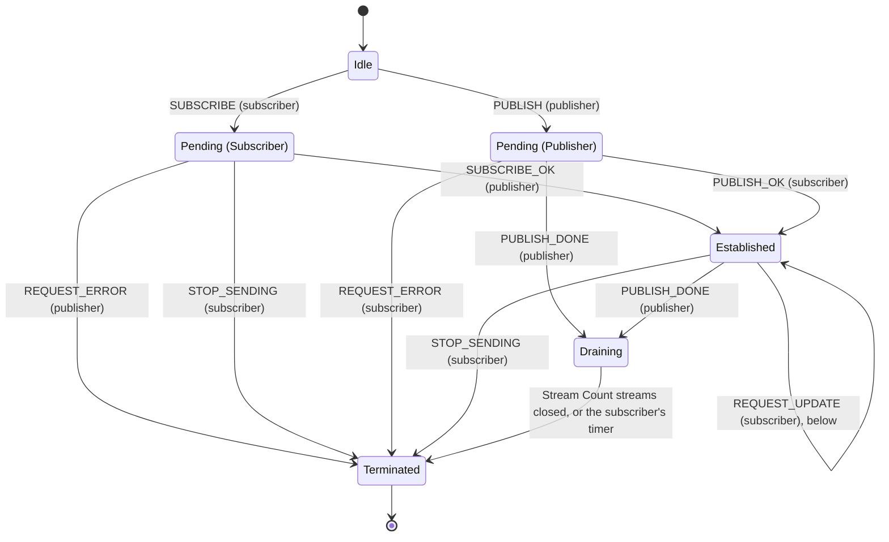

- **One answer.** A SUBSCRIBE gets exactly one SUBSCRIBE_OK or REQUEST_ERROR, and a PUBLISH exactly one PUBLISH_OK or REQUEST_ERROR (§5.1). Objects of a PUBLISH can come before its PUBLISH_OK (§5.1).
- **One subscription a track in each role.** A second is refused with `DUPLICATE_SUBSCRIPTION` (§5.1): [`fixtures/peer-subscribe/`](../fixtures/peer-subscribe/README.md). A PUBLISH for a track whose SUBSCRIBE is Pending (Subscriber) is accepted only after that subscription is Terminated (§5.1).
- **Established.** Objects flow while the Forward State is 1 (§5.1). The Track Alias comes with SUBSCRIBE_OK or PUBLISH (§11.1): [`fixtures/early-objects/`](../fixtures/early-objects/README.md).
- **Draining.** The publisher closes all its streams before PUBLISH_DONE, and may forget the subscription once it sent it (§10.11). The subscriber keeps it until the streams that the Stream Count names have closed, or until a timer (§10.11): [`fixtures/early-objects/`](../fixtures/early-objects/README.md), "SUBSCRIBE_OK, or a PUBLISH that is accepted, that reuses a Track Alias whose previous subscription received PUBLISH_DONE and is still draining", "A subscription ends while subgroup streams for it are open". On the stream of a PUBLISH that ended so: [`fixtures/request-update/`](../fixtures/request-update/README.md), "A publisher that ended its PUBLISH with PUBLISH_DONE and wants to close the session".
- **A malformed track.** The subscriber cancels the subscription and the FETCH requests of the same track (§2.4.2): "A track that a subscriber finds malformed, by any condition of §2.4.2".

Names in the code: `RequestState` and `Request::Subscribe` and `Request::Publish` of `crates/moqt/src/session.rs`, `SubscribePhase` and `PeerRequestState` of `crates/moqt/src/session/peer.rs`; `packages/moqt/src/core/requests.ts` and `packages/moqt/src/core/peer-requests.ts`. Draining is the alias's state: `crates/moqt/src/aliases.rs`, `AliasState` of `packages/moqt/src/core/incoming-subgroups.ts`.

## REQUEST_UPDATE of a subscription

The subscriber of an Established subscription, the sender of a SUBSCRIBE or the receiver of a PUBLISH, sends REQUEST_UPDATE on its stream (§10.9). Each gets exactly one REQUEST_OK or REQUEST_ERROR, in order. A refused update leaves the publisher one way on: PUBLISH_DONE with `UPDATE_FAILED` (§10.9.1).

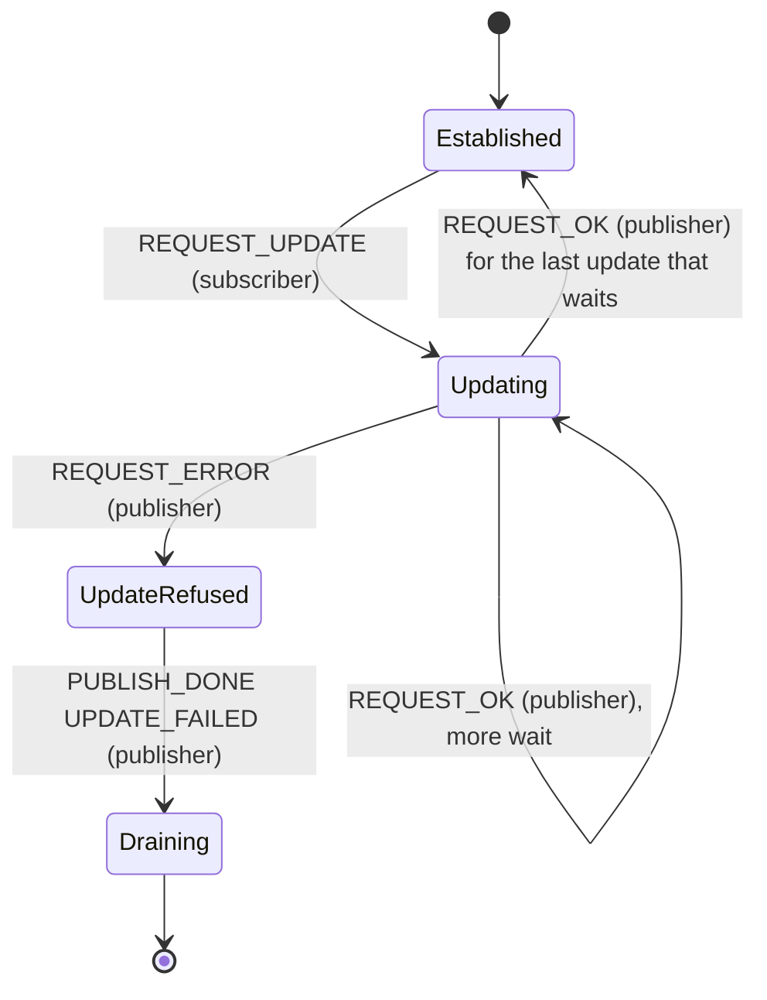

- A publisher may take several updates as one and answer the result with a single REQUEST_ERROR (§10.9.1). What the subscriber does with the answers that then never come: [`fixtures/update-answers/`](../fixtures/update-answers/README.md).
- What a publisher accepts: "REQUEST_UPDATE for an Established subscription that the receiver publishes to (on the stream of the peer's SUBSCRIBE, or of its own PUBLISH)". Elsewhere: [`fixtures/request-update/`](../fixtures/request-update/README.md).
- Names in the code: `PublishState::UpdateRefused` and `SubscribePhase::UpdateRefused` (Rust), `updateRefused` of `packages/moqt/src/core/requests.ts`.

## FETCH

A FETCH has two parts that go on side by side: its answer on the request stream, and its fetch stream, which can come before the answer (§10.12.3: "The FETCH_OK or REQUEST_ERROR can come at any time relative to object delivery").

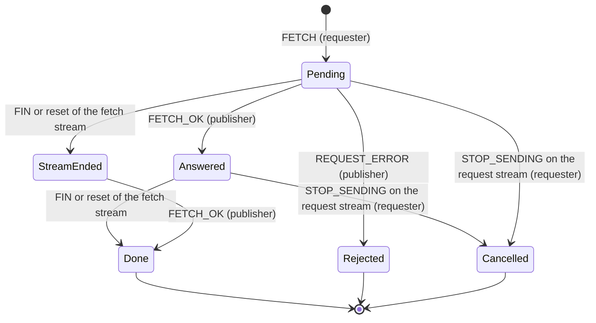

- **Keeping a FETCH.** §5.2 has the requester keep a FETCH until it cancels it, until REQUEST_ERROR, or until its fetch stream ends. Both sessions keep it until it was refused, until it was cancelled, or until both its FETCH_OK came and its fetch stream ended (Done). A FETCH whose stream ended and whose answer never comes stays in StreamEnded, and takes up one of the requester's requests until the caller cancels it: the session has no clock (`Session::fetch`, `crates/moqt/src/session/fetch.rs`; `fetch()`, `packages/moqt/src/core/requests.ts`).
- **Rejected.** Objects can have come on the fetch stream before the REQUEST_ERROR (§5.2).
- **Cancelled.** The requester MUST send STOP_SENDING for the request stream, and MAY for the fetch stream (§5.2); the publisher then resets both (§5.2).
- **A Joining FETCH** names a subscription that is Pending (Subscriber) or Established; the publisher holds it until the subscription is established or the FETCH times out (§10.12.2): [`fixtures/joining-request-id/`](../fixtures/joining-request-id/README.md), [`fixtures/peer-fetch/`](../fixtures/peer-fetch/README.md), `crates/moqt/src/session/peer.rs`.
- **Stream ends the draft does not name.** [`fixtures/own-requests/`](../fixtures/own-requests/README.md), "A FETCH of the peer whose fetch stream alone is stopped, by a publisher", [`fixtures/own-requests/`](../fixtures/own-requests/README.md).
- **REQUEST_UPDATE.** A refused update has the publisher reset the fetch stream (§10.9.1): [`fixtures/peer-fetch/`](../fixtures/peer-fetch/README.md).

## PUBLISH_NAMESPACE

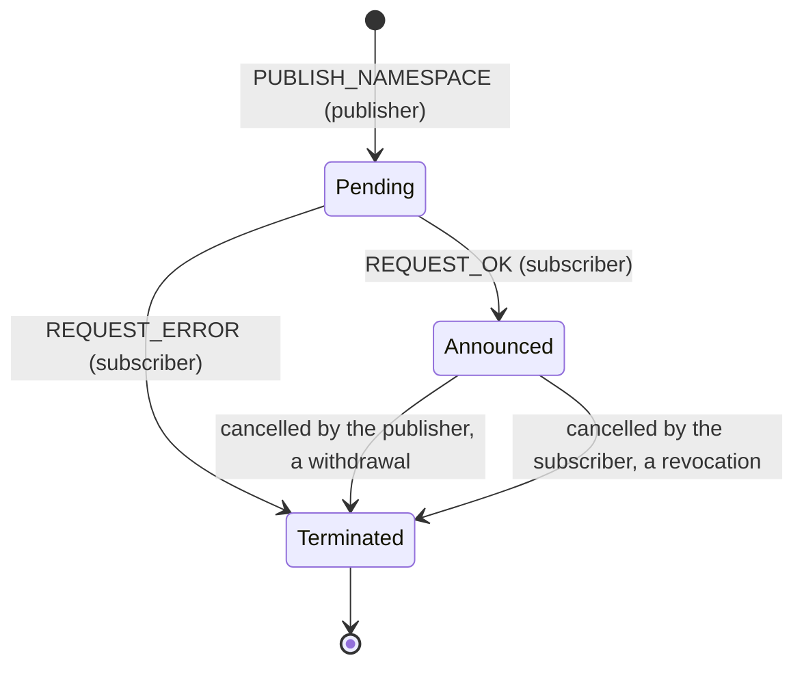

- **One answer**, the first message on the stream; a second is a protocol error (§6.2: "SHOULD close the session").
- **Withdrawn and revoked** by cancelling the request (§6.2, §3.3.2). How this end withdraws: "This endpoint withdraws a namespace it announced". A FIN that is no cancellation: [`fixtures/own-requests/`](../fixtures/own-requests/README.md), [`fixtures/own-requests/`](../fixtures/own-requests/README.md).
- A SUBSCRIBE or FETCH for a track under the namespace is no error after it was withdrawn (§6.2).

## SUBSCRIBE_NAMESPACE

The request, and each namespace the publisher names on its stream.

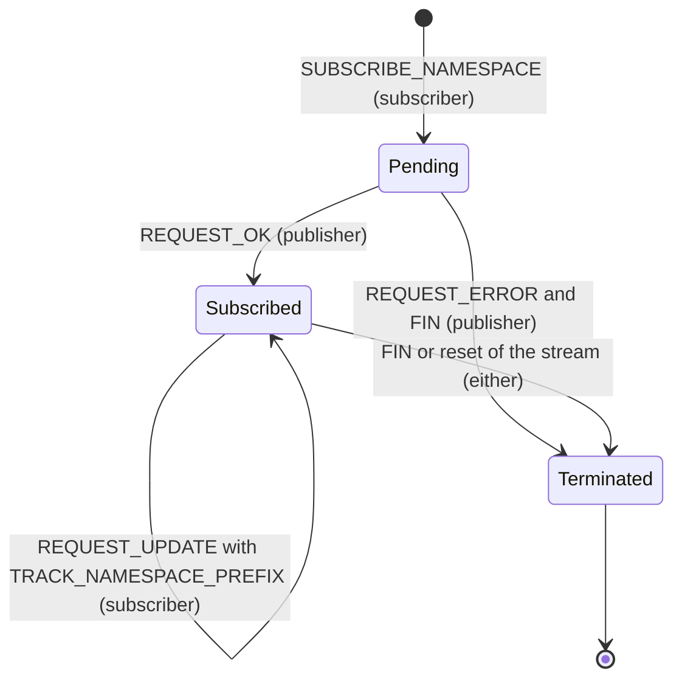

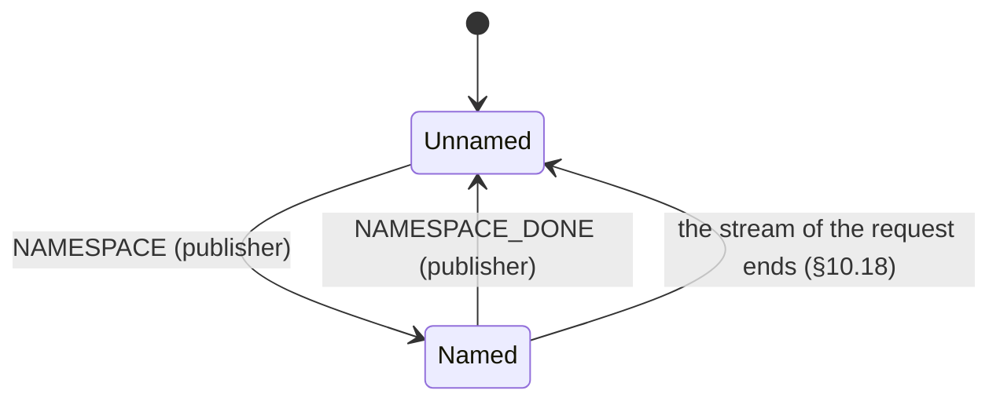

- **The first message** on the publisher's direction is REQUEST_OK or REQUEST_ERROR; any other closes the session with `PROTOCOL_VIOLATION` (§10.18). A prefix that overlaps an established SUBSCRIBE_NAMESPACE of the session is refused with `PREFIX_OVERLAP` (§10.18).
- **Ending.** §6.1 cancels a SUBSCRIBE_NAMESPACE "by closing the stream with either a FIN or RESET_STREAM": a FIN ends it, unlike the other requests ([`fixtures/own-requests/`](../fixtures/own-requests/README.md)). A subscriber treats the end of the stream as NAMESPACE_DONE for each namespace that is Named (§10.18). Subscriptions made by PUBLISH are not affected (§10.18).
- **A namespace.** NAMESPACE_DONE for one that is not Named closes the session with `PROTOCOL_VIOLATION` (§10.18). The namespaces a session keeps Named are bounded (`MAX_NAMESPACES_OF_A_SUBSCRIPTION`, `crates/moqt/src/session.rs`).
- **REQUEST_UPDATE.** A new prefix names the namespaces after its REQUEST_OK relative to it (§10.9.2); a refused update has the publisher close the stream (§10.9.1).

## The relay

What `crates/relay-core` keeps above the sessions of its peers: each track, where its Objects come from, who gets them, the streams that come before their Track Alias, and how the relay goes away. Each of its upstream and downstream requests also goes through the states above, in the session it is on.

### A track

A name is in one of three states, or has no entry at all. A source is an upstream subscription that is Established: a PUBLISH the relay accepted, or a SUBSCRIBE of the relay that a publisher accepted.

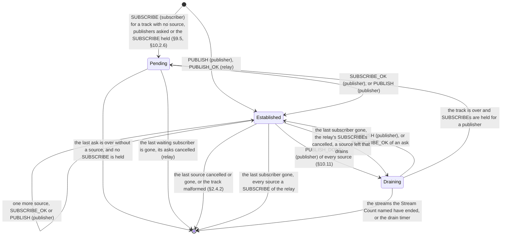

- **Pending.** No SUBSCRIBE_OK goes downstream before an upstream subscription is Established (§9.4). The relay sends its own SUBSCRIBE to the publishers of a matching namespace (§9.5): `crates/relay-core/src/tests/routing.rs`, `crates/relay-core/src/tests/routing.rs`. A SUBSCRIBE with `RENDEZVOUS_TIMEOUT` keeps the track Pending while nobody is asked: "A SUBSCRIBE for a track nobody publishes (RENDEZVOUS_TIMEOUT)". An edge with `--parent` asks the parent relay, and holds the track while its session is opened: "A relay above this one (relay, `--parent`)".
- **Established.** At least one source does not drain. A SUBSCRIBE gets SUBSCRIBE_OK at once (§9.5), and the publishers of the namespace are still asked, each one more source (§9.3): `crates/relay-core/src/tests/answers.rs`. A source that goes while another is left takes only its own Subgroups with it: `crates/relay-core/src/tests/sources.rs`.
- **Draining.** Every source said PUBLISH_DONE, and the relay waits for the streams their Stream Count named (§10.11), or for the drain timer. An ask of the relay can still be open then, sent before the drain or for a namespace announced during it; its SUBSCRIBE_OK makes the track Established again, and its subscribers get no PUBLISH_DONE. A track whose last subscriber goes cancels the relay's own SUBSCRIBEs and drains on with the sources that drain, with nobody left to tell when it ends. A SUBSCRIBE with `RENDEZVOUS_TIMEOUT` waits with the track; one without is refused: `crates/relay-core/src/tests/answers.rs`. While the track drains, the publishers of its namespace are not asked for a held SUBSCRIBE alone, which is in the [known gaps](moqt-implementation-notes.md#known-gaps-against-the-draft), under several publishers of one track
- **Over.** Every subscriber gets PUBLISH_DONE, with the code of why the track ended: `crates/relay-core/src/tests.rs`, `crates/relay-core/src/tests/sources.rs`. The last subscriber of a track whose sources came with PUBLISH does not end it: `crates/relay-core/src/tests/routing.rs`.

#### The relay's SUBSCRIBE to one publisher

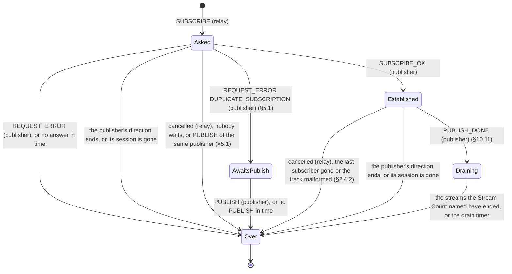

- **Asked.** An ask of the track: subscribers that come wait for the same answers (§9.4): `crates/relay-core/src/tests/answers.rs`. When the last ask of a Pending track is over, its waiting subscribers are refused: `crates/relay-core/src/tests/answers.rs`. A publisher whose ask ended without a source is not asked for the track again until it announces anew (row above on which publishers the relay asks).
- **A SUBSCRIBE_OK the track cannot take.** The track has as many sources as it takes (`crates/relay-core/src/tests/answers.rs`), or the answer carries a Mandatory Track Property the relay does not understand: the relay cancels the subscription (§3.3.2): `crates/relay-core/src/tests/answers.rs`, `crates/relay-core/src/tests/malformed.rs`.
- **AwaitsPublish.** The request is over on its stream; the relay waits for the PUBLISH that `DUPLICATE_SUBSCRIPTION` stands for (§5.1). When it comes, it is the source: `crates/relay-core/src/tests/routing.rs`.
- **A GOAWAY.** One on the request stream changes nothing: "GOAWAY (§10.4), received". One of the parent relay on its control stream has the relay open a new session there, whose subscriptions become further sources; the old ones end with the old session: "A relay above this one (relay, `--parent`)".

#### A PUBLISH

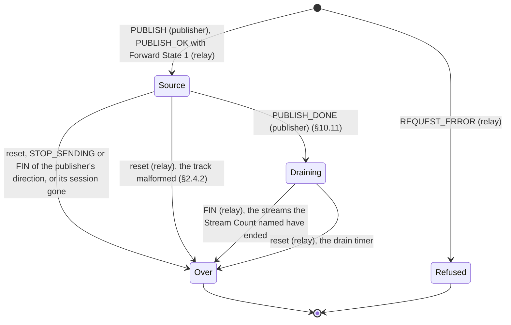

- **Source.** Accepted in whatever state the track is, up to the most sources a track takes: `crates/relay-core/src/tests/answers.rs`. The relay's own SUBSCRIBE to the same publisher gives way first (§5.1). The Forward State: `crates/relay-core/src/tests/routing.rs`. A track that came with PUBLISH stays without subscribers.
- **Over.** The publisher's FIN without PUBLISH_DONE ends the PUBLISH, unlike a SUBSCRIBE's: [`fixtures/own-requests/`](../fixtures/own-requests/README.md). A publisher whose connection goes: "A publisher whose connection goes".

Names in the code: `TrackPhase` and `TrackEnd` (`crates/relay-core/src/lib.rs`) for a track; `PendingTrack` and `UpstreamPhase` (`crates/relay-core/src/routing.rs`) for a track without a source and for the relay's SUBSCRIBE.

### A subscriber

The relay is the publisher of each downstream SUBSCRIBE.

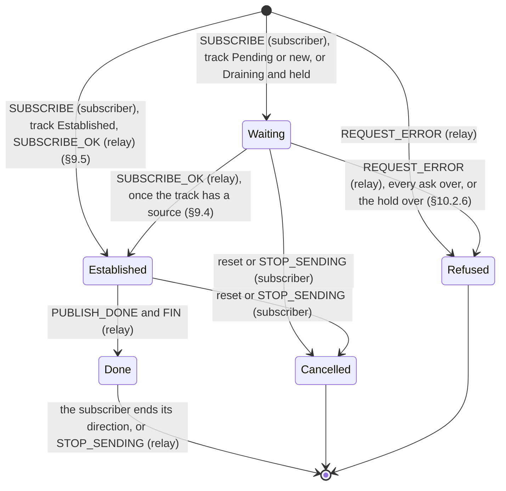

- **Waiting.** No SUBSCRIBE_OK before the track has an Established upstream subscription (§9.4). A held SUBSCRIBE is refused with `TIMEOUT` when its time is over and nobody is asked (§10.2.6); one whose asks are over gets what the last publisher answered, or `TIMEOUT` where none answered in time (§10.6.2). The rows: `crates/relay-core/src/tests/answers.rs`, `crates/relay-core/src/tests/answers.rs`, "A SUBSCRIBE for a track nobody publishes (RENDEZVOUS_TIMEOUT)". When the last waiting subscriber goes, what was asked for it is cancelled. A SUBSCRIBE held while its track drained is asked for when the drain ends; nobody taking the track before its time is over refuses it with `TIMEOUT`, and a publisher asked then still answers it.
- **Established.** Objects go out from the Start Location of its filter, while its Forward State is 1 (§5.1): `crates/relay-core/src/tests.rs`. A REQUEST_UPDATE: "REQUEST_UPDATE for an Established subscription that the receiver publishes to (on the stream of the peer's SUBSCRIBE, or of its own PUBLISH)".
- **Done.** PUBLISH_DONE with the Status Code of why it ended: `TRACK_ENDED` or `MALFORMED_TRACK` with the track (`crates/relay-core/src/tests.rs`), `TOO_FAR_BEHIND` for a subscriber that does not take what is sent (§8; `crates/relay-core/src/tests.rs`, `crates/relay-core/src/tests.rs`), `UPDATE_FAILED` after a refused update (§10.9.1). Streams the relay cannot finish are reset before it, and FIN follows it (§10.11): `crates/relay-core/src/tests.rs`. A subscriber that keeps its direction open: `crates/relay-core/src/tests.rs`.
- **Cancelled.** The relay resets the subscription's open streams. A FIN of the subscriber is no cancellation: [`fixtures/own-requests/`](../fixtures/own-requests/README.md), "STOP_SENDING on a request stream the peer opened". A subscriber whose session is gone is cancelled the same way.

#### A FETCH of a subscriber

Where a FETCH stands at the relay before its answer. The FETCH itself goes through the states of [FETCH](#fetch) towards the subscriber, and an upstream FETCH of the relay through them towards the publisher.

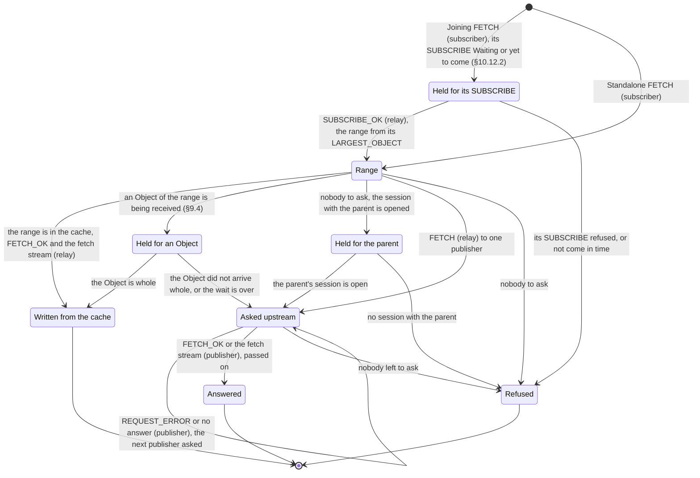

- **Range.** A Joining FETCH becomes a range of the track, counted from the LARGEST_OBJECT of the SUBSCRIBE_OK the relay sent: `crates/relay-core/src/tests/fetch.rs`, `crates/relay-core/src/tests/fetch.rs`, [`fixtures/joining-request-id/`](../fixtures/joining-request-id/README.md), `crates/relay/src/tests.rs`. `FILL_TIMEOUT` 0 is answered from the cache alone: `crates/relay-core/src/cache.rs`, `crates/relay-core/src/tests/cache.rs`.
- **Written from the cache.** `crates/relay-core/src/cache.rs`, `crates/relay-core/src/tests/cache.rs`.
- **Held for an Object.** No FETCH_OK while the relay lacks what it needs for one (§9.4): `crates/relay-core/src/tests/receipt.rs`.
- **Asked upstream.** One publisher at a time: `crates/relay-core/src/tests/fetch.rs`. Its waits: "A FETCH that does not come to its end".
- **Cancelled**, from any of these states, by the subscriber (§5.2): `crates/relay-core/src/tests/fetch.rs`. A track found malformed ends its FETCH requests with it (§2.4.2).

Names in the code: `Waiter` (`crates/relay-core/src/routing.rs`) for Waiting, `Subscriber` and `RequestSlot` (`crates/relay-core/src/lib.rs`) for a subscriber, and `Standing` (`crates/relay-core/src/fetch.rs`) for a FETCH.

### A subgroup stream before its Track Alias

A subgroup stream can arrive before the PUBLISH or the SUBSCRIBE_OK that gives its Track Alias, which travel on other streams. §11.4.2 lets a receiver abandon it or "buffer it for a brief period".

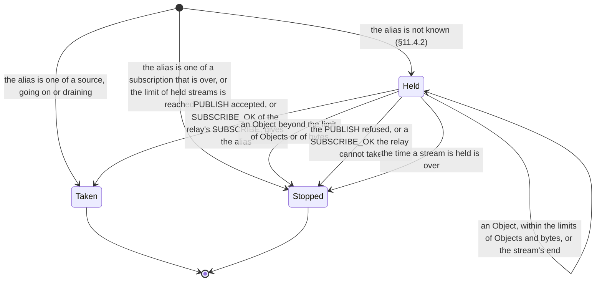

- **Held.** Within limits of streams, Objects, bytes and time for each session, the bytes counted as a client counts them: [`fixtures/early-objects/`](../fixtures/early-objects/README.md), `crates/relay-core/src/tests.rs`. The relay decides each stream and Object by the rule a client uses, with an answer that may always still come, where a client asks whether one of its SUBSCRIBEs waits; its own timer ends the wait.
- **Taken.** The held Objects, and the stream's end where it came, are fed to the track in the order they came. Which streams a track takes: `crates/relay-core/src/tests/sources.rs`.
- **Stopped.** STOP_SENDING with `INTERNAL_ERROR` at a limit, `CANCELLED` otherwise. A stream that ended while it was held is let go of without one.

Names in the code: `EarlyStream` (`crates/relay-core/src/lib.rs`).

### GOAWAY from the relay

The relay sends GOAWAY on the control stream in two cases: to every session when it is told to stop, and to one session that comes when it is full. Each session then goes through GoAwaySent of [the session](#the-session).

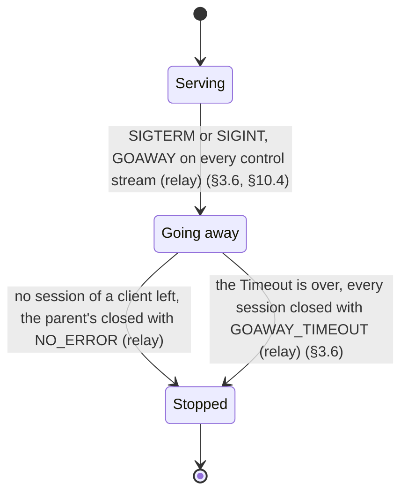

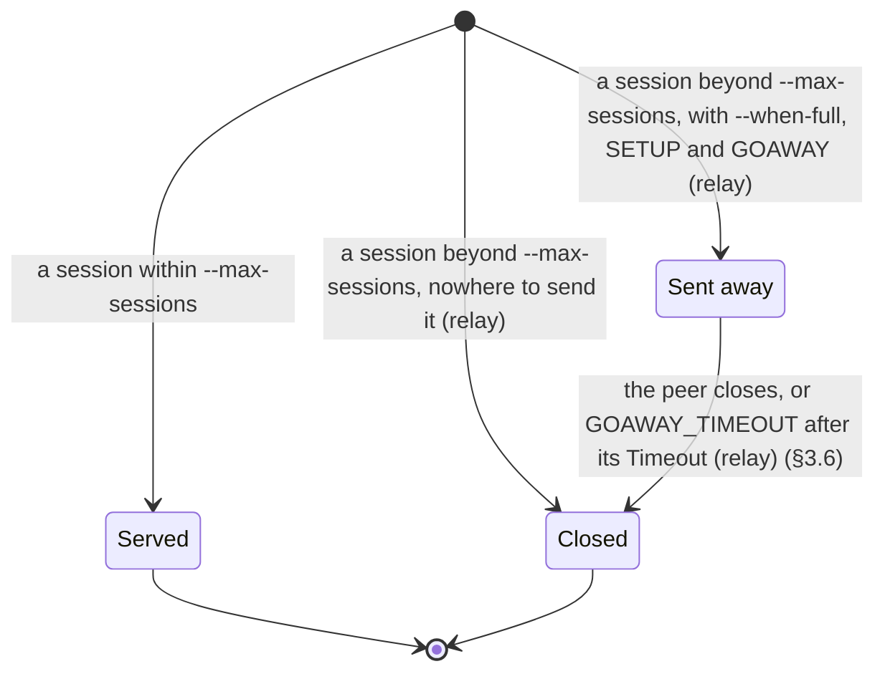

- **Going away.** The New Session URI is `--redirect-uri` towards a client, where an empty one has the client reuse its URI, and empty towards the parent (§10.4); the Timeout is `--goaway-timeout-ms`. Every request of a peer after the GOAWAY is refused with `GOING_AWAY` (§10.4). Connections that come are refused; a client whose handshake was under way, and the session with the parent relay, still open, and each gets the GOAWAY after its SETUP. What drains is what was taken before: the subscriptions and FETCH requests go on, and the relay does not unsubscribe upstream; its upstream subscriptions end with the sessions. The rest is the row's: `crates/relay-core/src/tests/going_away.rs`.
- **Sent away.** The URL of `--when-full`, with `sent-away=1` added, and a short Timeout. A session that came with that query, or that would be one more than the relay sends away at once, is closed at once; so is every session beyond `--max-sessions` without `--when-full`. Its peer's requests are refused with `GOING_AWAY` as above. A sent-away session does not count among the `--max-sessions`.

Names in the code: `Stopping` (`crates/relay/src/hub.rs`).
