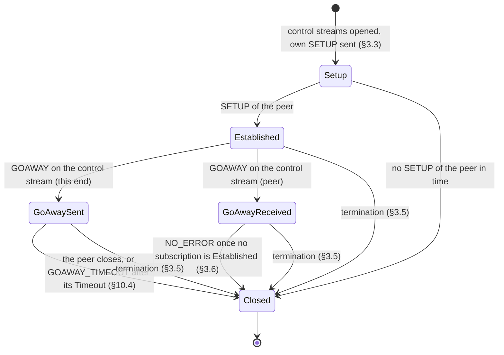
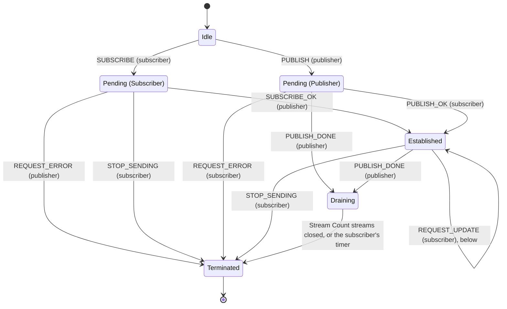
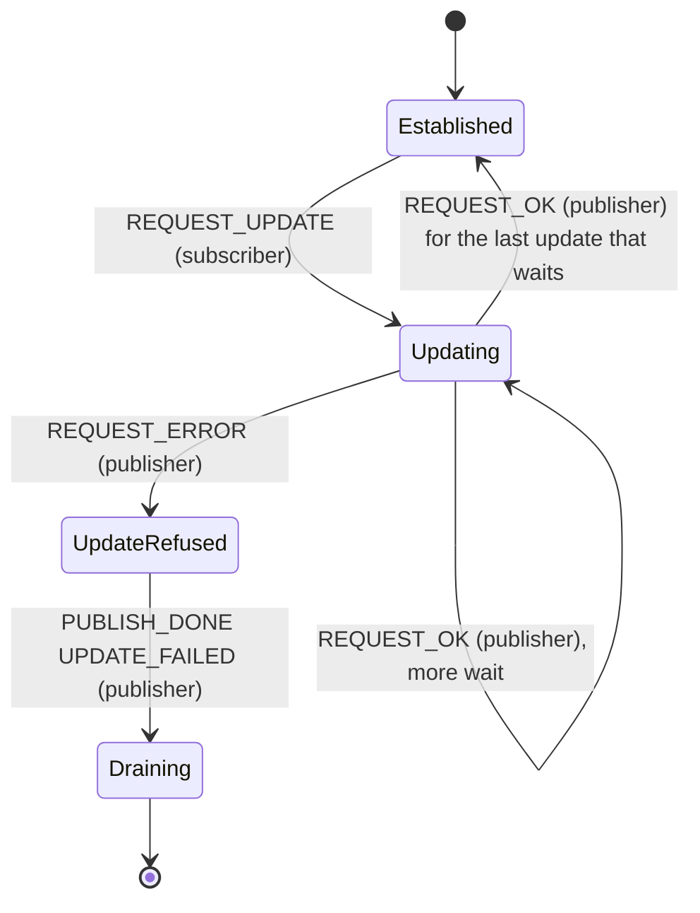
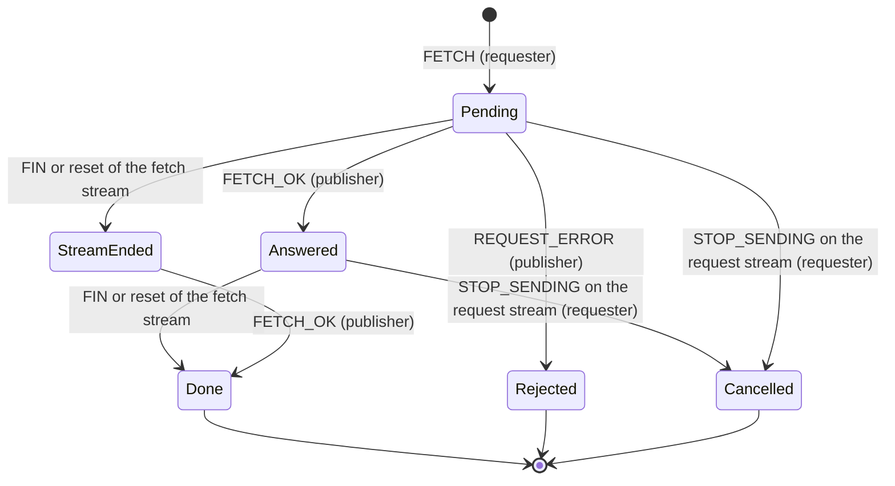
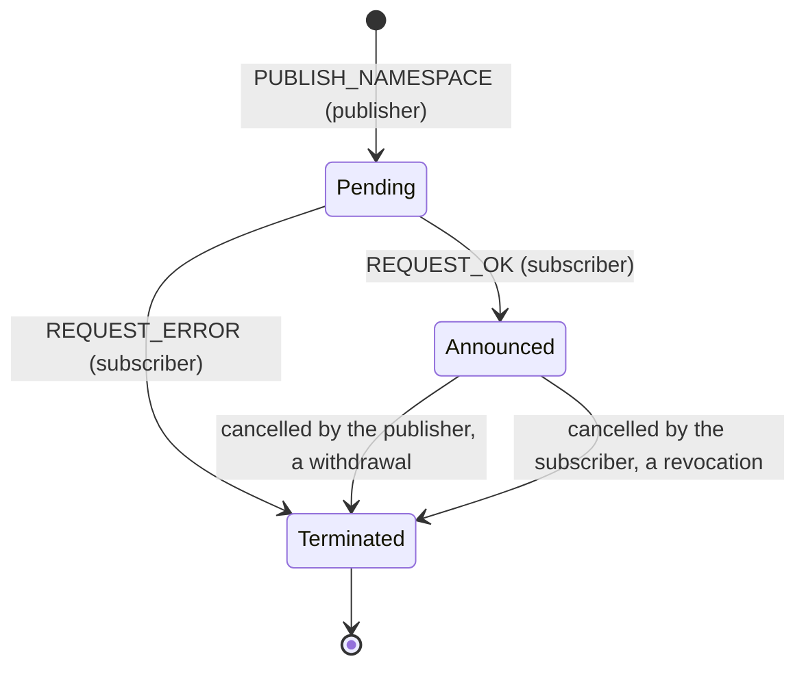
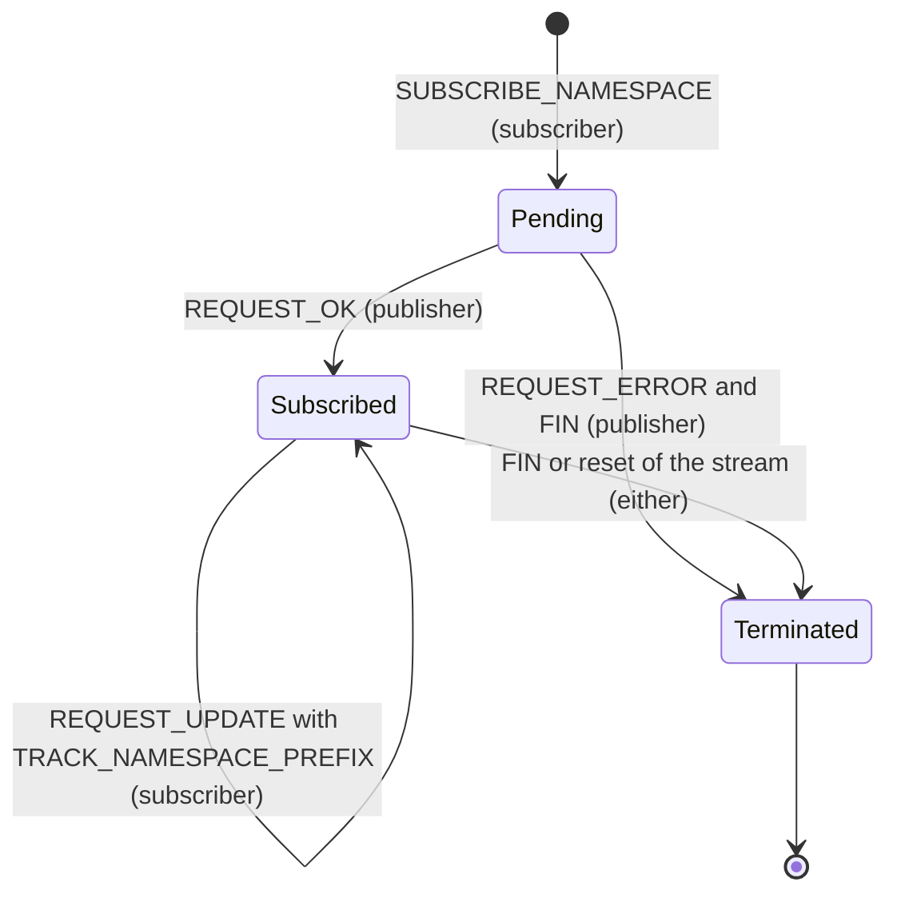
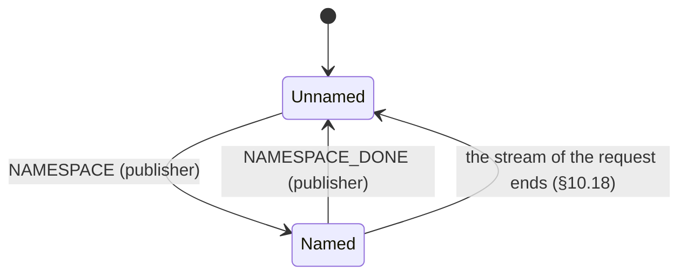

# MoQ Transport state models

The states that both MoQ Transport sessions keep, the Rust one (`crates/moqt`) and the TypeScript one (`packages/moqt`): the session, and each request on it. The states and their transitions are those of `draft-ietf-moq-transport-18`, with its section numbers. Where the draft is silent, contradicts itself or leaves a choice, a transition points to the row of the [implementation notes](moqt-implementation-notes.md) that decides it, by the row's Case; what the row decides is not repeated here. The relay's own states (a track, its sources, its subscribers) are outside this document.

Each diagram holds both ends of a request. A transition is labelled with the message or the stream event, and with the end that sends it, where it matters: `SUBSCRIBE_OK (publisher)`. A reset and a STOP_SENDING are the two ways to cancel a request (§3.3.2); a FIN is not one.

## The session

- **Setup.** Objects and requests of the peer can come before its SETUP; §3.3 has them buffered ("SHOULD"). What the clients do with them: "Objects and fetch streams that come before the peer's SETUP, at a client". How long a SETUP is waited for: "A peer that sends no SETUP".
- **Established.** Either end opens requests, each on a bidirectional stream of its own (§3.3). A control stream that closes closes the session with `PROTOCOL_VIOLATION` (§3.3).
- **After a GOAWAY.** The end that received it opens no new request (§10.4: "SHOULD NOT initiate new requests"); the requests that are open go on. The sender refuses requests whose Request ID is at or above the one its GOAWAY names with `GOING_AWAY` (§10.4). A second GOAWAY on the control stream closes the session with `PROTOCOL_VIOLATION` (§10.4). What each implementation checks of a GOAWAY, and what a client does next: "GOAWAY (§10.4), received". When the relay sends one: "GOAWAY (§10.4), sent by the relay".
- **Closed.** By `CLOSE_WEBTRANSPORT_SESSION` with a Session Termination Error Code (§3.5); every request of the session ends with it.

## Every request

These hold for each request below, and are not drawn in each diagram:

- **Cancelled.** Either end cancels a request by resetting or stopping the directions of its stream that are still open (§3.3.2). The request is then over at both ends.
- **Refused before any processing.** REQUEST_ERROR and a FIN (§3.3.2). What still comes from the requester on that stream: "What still comes on the stream of a request of the peer that was refused".
- **GOAWAY on its stream.** The requester re-issues that request, at the URI the GOAWAY names or on this session, and closes the old stream (§10.4).
- **Not sent, or not answered.** A request that gets no stream from the peer, or no answer, is over at the requester: "A request that waits for a stream", "A request the peer does not answer".
- **A stream end the draft does not name.** "A request stream of the peer that ends with a FIN inside its first message", "The peer sends STOP_SENDING on a request stream that this endpoint opened", "The peer resets its direction of a request stream that this endpoint opened", "A requester finishes its direction of a request stream and does nothing else (no reset, no STOP_SENDING)".
- **Request IDs.** "Request ID parity; Redirect in REQUEST_ERROR", "Request IDs from the peer that arrive out of order or leave gaps".
- **A request the end does not serve.** "SUBSCRIBE, PUBLISH or PUBLISH_NAMESPACE opened by the peer, received by an implementation that has no responder side (the clients)", "Request that the draft defines and XmoQ does not implement, opened by the peer (SUBSCRIBE_TRACKS), and a FETCH or SUBSCRIBE_NAMESPACE that the receiver does not serve".

## A subscription: SUBSCRIBE and PUBLISH

The states of §5.1, with Draining after PUBLISH_DONE (§10.11), where the subscriber still takes the streams the publisher opened before it.

- **One answer.** A SUBSCRIBE gets exactly one SUBSCRIBE_OK or REQUEST_ERROR, and a PUBLISH exactly one PUBLISH_OK or REQUEST_ERROR (§5.1). Objects of a PUBLISH can come before its PUBLISH_OK (§5.1).
- **One subscription a track in each role.** A second is refused with `DUPLICATE_SUBSCRIPTION` (§5.1): "A SUBSCRIBE the peer sends for a track this endpoint is the publisher of already". A PUBLISH for a track whose SUBSCRIBE is Pending (Subscriber) is accepted only after that subscription is Terminated (§5.1).
- **Established.** Objects flow while the Forward State is 1 (§5.1). The Track Alias comes with SUBSCRIBE_OK or PUBLISH (§11.1): "The Track Alias of a SUBSCRIBE of the peer that is accepted".
- **Draining.** The publisher closes all its streams before PUBLISH_DONE, and may forget the subscription once it sent it (§10.11). The subscriber keeps it until the streams that the Stream Count names have closed, or until a timer (§10.11): "After PUBLISH_DONE", "SUBSCRIBE_OK, or a PUBLISH that is accepted, that reuses a Track Alias whose previous subscription received PUBLISH_DONE and is still draining", "A subscription ends while subgroup streams for it are open". On the stream of a PUBLISH that ended so: "Any message that arrives on the request stream of a PUBLISH after the publisher sent PUBLISH_DONE for it, whether the PUBLISH was pending or established", "A publisher that ended its PUBLISH with PUBLISH_DONE and wants to close the session".
- **A malformed track.** The subscriber cancels the subscription and the FETCH requests of the same track (§2.4.2): "A track that a subscriber finds malformed, by any condition of §2.4.2".

Names in the code: `RequestState` and `Request::Subscribe` and `Request::Publish` of `crates/moqt/src/session.rs`, `SubscribePhase` and `PeerRequestState` of `crates/moqt/src/session/peer.rs`; `packages/moqt/src/core/requests.ts` and `packages/moqt/src/core/peer-requests.ts`. Draining is the alias's state: `crates/moqt/src/aliases.rs`, `AliasState` of `packages/moqt/src/core/incoming-subgroups.ts`.

## REQUEST_UPDATE of a subscription

The subscriber of an Established subscription, the sender of a SUBSCRIBE or the receiver of a PUBLISH, sends REQUEST_UPDATE on its stream (§10.9). Each gets exactly one REQUEST_OK or REQUEST_ERROR, in order. A refused update leaves the publisher one way on: PUBLISH_DONE with `UPDATE_FAILED` (§10.9.1).

- A publisher may take several updates as one and answer the result with a single REQUEST_ERROR (§10.9.1). What the subscriber does with the answers that then never come: "Answers to the REQUEST_UPDATEs a subscriber sent, received".
- What a publisher accepts: "REQUEST_UPDATE for an Established subscription that the receiver publishes to (on the stream of the peer's SUBSCRIBE, or of its own PUBLISH)". Elsewhere: "REQUEST_UPDATE on any other request stream of a client".
- Names in the code: `PublishState::UpdateRefused` and `SubscribePhase::UpdateRefused` (Rust), `updateRefused` of `packages/moqt/src/core/requests.ts`.

## FETCH

A FETCH has two parts that go on side by side: its answer on the request stream, and its fetch stream, which can come before the answer (§10.12.3: "The FETCH_OK or REQUEST_ERROR can come at any time relative to object delivery").

- **Keeping a FETCH.** §5.2 has the requester keep a FETCH until it cancels it, until REQUEST_ERROR, or until its fetch stream ends. Both sessions keep it until it was refused, until it was cancelled, or until both its FETCH_OK came and its fetch stream ended (Done). A FETCH whose stream ended and whose answer never comes stays in StreamEnded, and takes up one of the requester's requests until the caller cancels it: the session has no clock (`Session::fetch`, `crates/moqt/src/session/fetch.rs`; `fetch()`, `packages/moqt/src/core/requests.ts`).
- **Rejected.** Objects can have come on the fetch stream before the REQUEST_ERROR (§5.2).
- **Cancelled.** The requester MUST send STOP_SENDING for the request stream, and MAY for the fetch stream (§5.2); the publisher then resets both (§5.2).
- **A Joining FETCH** names a subscription that is Pending (Subscriber) or Established; the publisher holds it until the subscription is established or the FETCH times out (§10.12.2): "The Joining Request ID of a Joining FETCH, received", "A Joining FETCH whose SUBSCRIBE is Pending, or is over when the FETCH is to be answered".
- **Stream ends the draft does not name.** "The publisher finishes or resets its direction of the request stream of a FETCH", "A FETCH of the peer whose fetch stream alone is stopped, by a publisher", "A fetch stream whose Request ID is no open FETCH of the receiver".
- **REQUEST_UPDATE.** A refused update has the publisher reset the fetch stream (§10.9.1): "REQUEST_UPDATE for a FETCH, received".

## PUBLISH_NAMESPACE

- **One answer**, the first message on the stream; a second is a protocol error (§6.2: "SHOULD close the session").
- **Withdrawn and revoked** by cancelling the request (§6.2, §3.3.2). How this end withdraws: "This endpoint withdraws a namespace it announced". A FIN that is no cancellation: "A responder finishes its direction of the stream of a PUBLISH_NAMESPACE after its REQUEST_OK, and does nothing else", "A requester finishes its direction of a request stream and does nothing else (no reset, no STOP_SENDING)".
- A SUBSCRIBE or FETCH for a track under the namespace is no error after it was withdrawn (§6.2).

## SUBSCRIBE_NAMESPACE

The request, and each namespace the publisher names on its stream.

- **The first message** on the publisher's direction is REQUEST_OK or REQUEST_ERROR; any other closes the session with `PROTOCOL_VIOLATION` (§10.18). A prefix that overlaps an established SUBSCRIBE_NAMESPACE of the session is refused with `PREFIX_OVERLAP` (§10.18).
- **Ending.** §6.1 cancels a SUBSCRIBE_NAMESPACE "by closing the stream with either a FIN or RESET_STREAM": a FIN ends it, unlike the other requests ("A requester finishes its direction of a request stream and does nothing else (no reset, no STOP_SENDING)"). A subscriber treats the end of the stream as NAMESPACE_DONE for each namespace that is Named (§10.18). Subscriptions made by PUBLISH are not affected (§10.18).
- **A namespace.** NAMESPACE_DONE for one that is not Named closes the session with `PROTOCOL_VIOLATION` (§10.18). The namespaces a session keeps Named are bounded (`MAX_NAMESPACES_OF_A_SUBSCRIPTION`, `crates/moqt/src/session.rs`).
- **REQUEST_UPDATE.** A new prefix names the namespaces after its REQUEST_OK relative to it (§10.9.2); a refused update has the publisher close the stream (§10.9.1).
