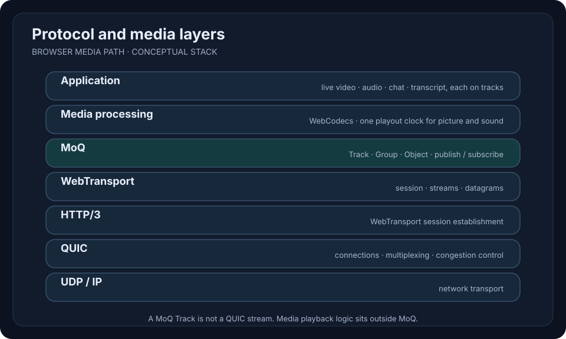

# Protocols and layers

This is the **proposed browser media path**, not a claim that all layers have been integrated.

MoQ is a media Object distribution protocol, not a replacement for the entire WebRTC media stack. One WebTransport session can multiplex streams and datagrams. A MoQ Track is **not** the same thing as a QUIC stream.

## MoQ implementation — decided, partly implemented

XmoQ implements the MoQ Transport layer itself, in Rust (relay and client) and in TypeScript (browser), pinned to `draft-ietf-moq-transport-18` (WebTransport subprotocol `moqt-18`). QUIC and WebTransport are not reimplemented: Rust uses existing crates and the browser uses its native `WebTransport`.

What exists is listed in the [roadmap](roadmap.md), Phase 0b.

The relay accepts WebTransport only, not native QUIC. Browsers can use nothing else, the Rust CLI can use WebTransport as well, and one path means one implementation and one set of interop runs.

The Rust side uses `web-transport-quinn` 0.13.2 for WebTransport (the latest release on crates.io when read on 2026-10-10), with `ring` as its crypto backend. Everything that touches it is in one file of `crates/moqt-io`, behind a `Connection` trait whose contract is checked by the same tests on an in-memory connection and on a real loopback connection. Records: the [comparison](experiments/2026-10-10-webtransport-library-comparison.md) and the [switch](experiments/2026-10-10-webtransport-library-switch.md).

- **Why `web-transport-quinn`:** a viewer has to be told apart "the broadcast ended", "the server refused" and "the connection broke". That needs the Session Termination Error Code and reason of a session the relay closes to reach the browser, and this library sends them (CLOSE_WEBTRANSPORT_SESSION); Chromium 156 read both from the own relay. It also maps stream error codes into the WebTransport range, so no mapping is kept in XmoQ.
- **Why not `wtransport` 0.7.2,** which the relay was first written on and the `moqtail` peers use: it cannot send CLOSE_WEBTRANSPORT_SESSION, so a browser sees "Connection lost." without code or reason, and no issue or pull request upstream asks for it. It does not map stream codes either; the pull request that would has not moved since 2024-09.
- **What the switch cost:** a stream that has arrived and was not accepted yet when the connection closes can be lost. `wtransport` handed such a stream over; this library returns the connection error first (`poll_accept_uni` and `poll_accept_bi`, `src/session.rs`). So "the peer's transport has it" is not "the peer will read it", and a publisher that closes right after its last stream cannot rely on the transport. XmoQ answers this one level up: after PUBLISH_DONE the relay ends its direction of the request stream with a FIN once every stream the Stream Count named has ended, and the publisher waits for that before closing (see the [implementation notes](moqt-implementation-notes.md)).
- **What stays as it was:** the `moqtail` peers do not map stream codes. A code they send arrives without a code on the XmoQ side, and a code XmoQ sends arrives at them as the mapped number. The interop runs pass with that.

Where draft 18 is silent or contradicts itself, both implementations follow [MoQ Transport implementation notes](moqt-implementation-notes.md).

- **Why own implementation:** the goal of the project is to understand and own the protocol. The Phase 0 runs also showed limits in each library: `moq-dev/moq` keeps the moq-lite model in MOQT mode with deliberate deviations and failed most browser-to-browser late joins; the `moqtail` crate has no client API, so a Rust client already has to drive SETUP and request streams itself.
- **Why not moq-lite:** it is an individual draft with its own wire format, not IETF MoQ Transport.
- **Why draft 18:** it is the version that passed in Phase 0 with both `moqtail` and `moq-dev/moq`, and the current target of the cross-implementation interop runner. Draft 22 is current, but the published `moq-dev/moq` packages encode it as draft 21, so no tested peer for it exists here.
- **How conformance is checked:** the `moqtail` relay and browser client from Phase 0 stay as interop peers. Writing both ends alone would let the same misreading pass on both sides. Each own component is first run against a `moqtail` peer.

The libraries that were considered, and what each Phase 0 run showed, are in [MoQ library candidates](moq-libraries.md).

The implementation follows the draft text, not library behaviour and not model memory. The scope starts with SETUP, PUBLISH_NAMESPACE, PUBLISH, SUBSCRIBE and subgroup streams; other messages are added when a roadmap item needs them.

## Discussed

- MoQ over WebTransport for browser streaming.
- WebCodecs for browser media processing.
- Rust relay and terminal client.

## Undecided or requiring validation

- Codec, media packaging, keyframe handling and A/V synchronization.
- Native CLI transport, decoder and audio output.
- Chat as MoQ Track versus a different application transport.
- Reactions semantics and persistence.
- Relay ↔ Durable Objects protocol.

## Primary specifications

- [IETF MoQ](https://datatracker.ietf.org/doc/draft-ietf-moq-transport/)
- [W3C WebTransport](https://www.w3.org/TR/webtransport/)
- [W3C WebCodecs](https://www.w3.org/TR/webcodecs/)
- [Cloudflare Durable Objects](https://developers.cloudflare.com/durable-objects/)
